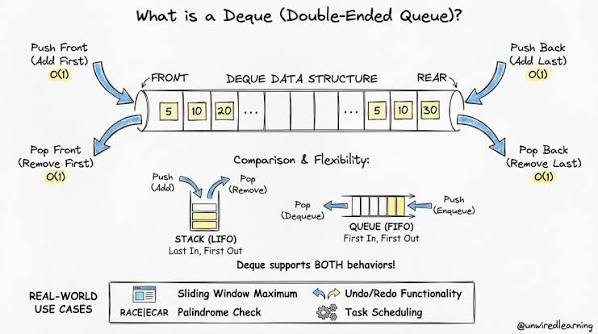

# Queue

A queue is a data structure that follows FIFO (First In, First Out). The first item you add is the first item you remove. If you add 10, 20, and 30 in that order, the queue gives you 10 first. A stack would give you 30 first.

A queue has two ends. The front holds the next item to remove. The rear holds the most recently added item.

enqueue is a push_back, and dequeue is a pop_front.

enqueue - push_back
dequeue - pop_front

## Circular queue

circular array queue in C, also called a ring buffer.

rear can be less than front. They’re array indices, and each wraps independently. rear is the next slot to write, while front is the next slot to read.

## Deque

| Operation | Steps |
|---|---|
| `push_back()` | Write at `rear`, then move `rear` forward |
| `pop_front()` | Read at `front`, then move `front` forward |
| `push_front()` | Move `front` backward, then write there |
| `pop_back()` | Move `rear` backward, then read there |

<p align="center">
  
</p>

## Priority queue

In a regular queue, the first item inserted leaves first. In a priority queue, the highest-priority item leaves first, regardless of arrival order.

value is the data. priority determines when it gets removed. For our implementation, a smaller priority number means higher priority.

```
typedef struct
{
    int value;
    int priority;
} Item;
```

Unlike our circular deque, this implementation keeps all items together at indices 0 through count - 1. We only need count; we won’t use front or rear.

| Index | Value | Priority |
|---:|---:|---:|
| 0 | 10 | 3 |
| 1 | 20 | 1 |
| 2 | 30 | 2 |
| 3 | 40 | 1 |


Removal:
1. Search for the item with the smallest priority number.
2. Save that item so the caller can use it.
3. Shift subsequent items left to close its gap.
4. Decrement count.

